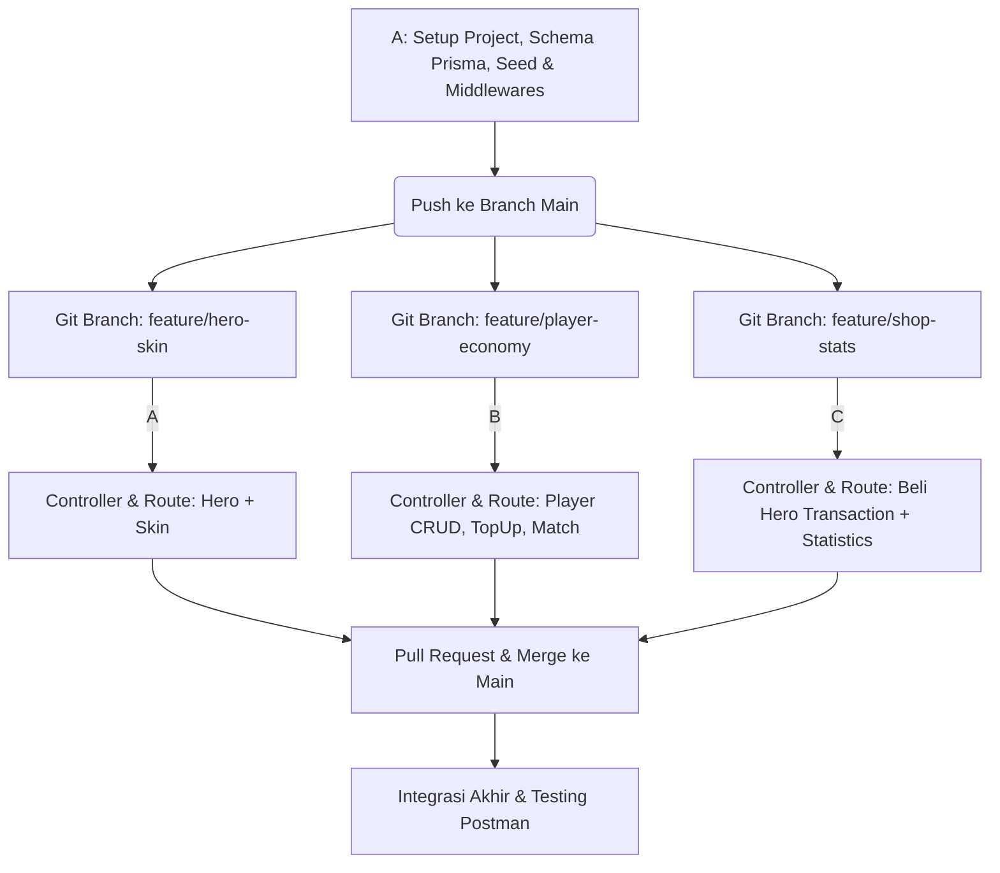

# 📋 Pembagian Tugas Penugasan Modul 4 - Backend Express MLBB Shop

**Kelompok:** A16  
**Repository GitHub:** `pweb-express-A16-2026`  
**Tech Stack:** Express 5 + TypeScript + Prisma ORM 7 (`prisma@7`) + PostgreSQL di Neon (`@prisma/adapter-neon`)

---

## 👥 Profil Anggota & Ringkasan Peran

| Nama | Peran Utama | Fokus Utama |
| :--- | :--- | :--- |
| **A** | **Lead Setup & Catalog Engineer** | Inisiasi Project, Database & Seed, Core Middlewares, Hero & Skin Modules |
| **B** | **Player & Economy Engineer** | Management Player CRUD, Top-Up System, Match Reward System |
| **C** | **Shop Engine & Analytics Engineer** | Transactional Beli Hero Engine, Store Statistics, Integration & Postman Verification |

---

## 🎯 Detail Pembagian Tugas & Beban Kerja

---

### 1. A — Setup, Inisialisasi, Katalog (Hero & Skin)

**Fokus Utama:** Menyiapkan fondasi project, skema Prisma, data seeder, middleware dasar, serta endpoint katalog Hero dan Skin.

#### A. Inisialisasi Project & Fondasi (Tahap Awal - Dikerjakan Pertama Kali)
- Inisialisasi project Express 5 + TypeScript + Prisma 7 + Driver Adapter Neon.
- Membuat file `tsconfig.json`, `.gitignore`, dan konfigurasi `prisma.config.ts`.
- Menyusun skema Prisma (`prisma/schema.prisma`) untuk model `Hero`, `Skin`, `Player`, `PlayerHero`, serta 4 Enum (`Role`, `Lane`, `Rarity`, `Currency`).
- Membuat script seeder (`prisma/seed.ts`) yang membaca dataset `data/heroes.json` & `data/skins.json` serta mengisikan data awal player.
- Mengimplementasikan helper utilitas: `src/utils/http-error.ts`, `src/utils/response.ts`, dan `src/utils/parse.ts`.
- Mengimplementasikan middleware global: `logger`, `notFound`, dan `errorHandler`.

#### B. Implementasi Endpoint Fitur (Hero & Skin)
- **`/health` (GET):** Health check koneksi server dan database Neon.
- **`/api/heroes` (GET):** Menampilkan daftar hero dengan dukungan query parameter:
  - `page` & `limit` (pagination).
  - `search` (case-insensitive search nama hero).
  - `role` (filtering berdasarkan role enum).
- **`/api/heroes/:hero_id` (GET):** Menampilkan detail hero beserta relasi skin-nya (`include`).
- **`/api/heroes` (POST):** Membuat hero baru (Validasi: kelengkapan data `400`, duplikasi nama `409`).
- **`/api/skins` (GET):** Menampilkan daftar skin beserta nama hero pemiliknya (`include`) dengan query parameter:
  - `page` & `limit`.
  - `heroId` (filtering per hero).
  - `rarity` (filtering enum rarity).
- **`/api/skins/:skin_id` (GET):** Detail skin beserta relasi hero.

---

### 2. B — Player Management & Modul Ekonomi

**Fokus Utama:** Mengembangkan manajemen identitas player (CRUD Player) serta sistem penambahan saldo (Top Up Diamond dan Match BP Rewards).

#### A. Player Management (CRUD)
- **`/api/players` (POST):** Pendaftaran player baru.
  - Saldo default otomatis: `10.000 BP` dan `0 Diamond`.
  - Validasi: Nickname kosong `400`, Nickname sudah terdaftar `409`.
- **`/api/players/:player_id` (GET):** Menampilkan detail player beserta daftar hero yang dimilikinya (`heroes` array dengan `heroId`, `name`, `currency`, `pricePaid`).
- **`/api/players/:player_id` (PATCH):** Memperbarui nickname player.
  - Validasi: Player tidak ditemukan `404`, Nickname kosong `400`, Nickname sudah dipakai `409`.
- **`/api/players/:player_id` (DELETE):** Menghapus player (dengan efek `onDelete: Cascade` pada data hero miliknya).

#### B. Modul Ekonomi Player (Top Up & Match Rewards)
- **`/api/players/:player_id/topup` (POST):** Menambahkan saldo Diamond player.
  - Validasi: `amount` bukan integer $> 0$ `400`, Player tidak ada `404`.
  - Menggunakan atomic update `increment` pada field `diamond`.
- **`/api/players/:player_id/matches` (POST):** Menambahkan Battle Point (BP) berdasarkan hasil pertandingan.
  - Input: `result` (`WIN` atau `LOSE`).
  - Aturan: `WIN` $+300\text{ BP}$, `LOSE` $+100\text{ BP}$.
  - Validasi: `result` bukan WIN/LOSE `400`, Player tidak ada `404`.

---

### 3. C — Transactional Shop Engine & Store Statistics

**Fokus Utama:** Mengembangkan logika transaksi kompleks (Beli Hero dengan urutan pengujian ketat & database transaction) serta pengolahan data statistik toko.

#### A. Shop Engine (Beli Hero)
- **`/api/players/:player_id/heroes` (POST):** Endpoint utama pembelian hero menggunakan `BP` atau `DIAMOND`.
- **Implementasi Chain Validation (Urut dari atas ke bawah):**
  1. `heroId` kosong / `currency` bukan BP/DIAMOND $\rightarrow$ `400 Bad Request`.
  2. Player tidak ditemukan $\rightarrow$ `404 Not Found`.
  3. Hero tidak ditemukan $\rightarrow$ `404 Not Found`.
  4. Harga hero untuk `currency` yang dipilih kosong/null $\rightarrow$ `400 Bad Request`.
  5. Player sudah memiliki hero tersebut $\rightarrow$ `409 Conflict`.
  6. Saldo player kurang dari harga hero $\rightarrow$ `400 Bad Request`.
- **Implementasi Database Transaction (`prisma.$transaction`):**
  - Mengurangi saldo `bp` atau `diamond` player (`decrement`).
  - Meng-insert record ke tabel `PlayerHero` (`currency`, `pricePaid`).

#### B. Store Statistics & Verification
- **`/api/statistics` (GET):** Menampilkan analitik keseluruhan toko MLBB:
  - `totalPlayers`: `prisma.player.count()`.
  - `totalHeroesOwned`: `prisma.playerHero.count()`.
  - `totalDiamond`: `prisma.player.aggregate({ _sum: { diamond: true } })`.
  - `mostOwnedHero`: `prisma.playerHero.groupBy({ by: ['heroId'], _count: { heroId: 'desc' }, take: 1 })`.
  - `heroesPerRole`: `prisma.hero.groupBy({ by: ['role'], _count: { id: true } })`.
- **Pengujian & Integrasi:**
  - Import dan eksekusi testcase Postman resmi.
  - Memastikan seluruh skenario pengujian pas dan sesuai gambar acuan di soal penugasan.

---

## 🛠️ Strategi Pengerjaan Paralel & Alur Git Workflow

Agar seluruh anggota dapat bekerja secara mandiri tanpa terjadi *conflict* pada repositori GitHub, alur pengerjaan diatur sebagai berikut:

### Langkah-langkah Eksekusi:

1. **Step 1 (Day 1 Morning - A):**
   - A membuat repository `pweb-express-A16-2026`, melakukan setup dasar Prisma, skema DB Neon, script `seed.ts`, serta utilitas/middleware dasar.
   - Panggilan `npx prisma migrate dev` dan `npx prisma db seed` dijalankan.
   - Mengisi template `.env.example` dan melakukan commit ke branch `main`.

2. **Step 2 (Day 1 Afternoon - Parallel Branching):**
   - **B** membikin branch `feature/player-economy` dari `main`.
   - **C** membikin branch `feature/shop-stats` dari `main`.
   - **A** membikin branch `feature/hero-skin` dari `main`.

3. **Step 3 (Day 1 Evening to Day 2 - Modul Implementation):**
   - A mengerjakan controller/routes di `src/controllers/heroController.ts`, `src/controllers/skinController.ts`.
   - B mengerjakan controller/routes di `src/controllers/playerController.ts`.
   - C mengerjakan controller/routes di `src/controllers/shopController.ts` dan `src/controllers/statisticController.ts`.

4. **Step 4 (Day 3 - Integration & Pull Request):**
   - Setiap anggota membuat Pull Request (PR) ke branch `main`.
   - Lakukan code review singkat antar anggota.
   - Pengujian bersama menggunakan file Postman Collection yang disediakan.

---

## 📌 Check-list Penyerahan Penugasan

- [ ] Repositori GitHub dibuat bersifat **Public** dengan nama `pweb-express-A16-2026`.
- [ ] File `.env` **TIDAK** di-commit ke GitHub (sudah terdaftar di `.gitignore`).
- [ ] Script `npm run dev` dapat berjalan tanpa error.
- [ ] File database seeder `prisma/seed.ts` berjalan sukses (133 Hero, 892 Skin, 3 Player awal).
- [ ] Seluruh endpoint mengembalikan format JSON standar (properti `status`, `message`, `data`, dan `metadata` jika ada pagination).
- [ ] Seluruh anggota kelompok memahami bagian kodenya masing-masing untuk persiapan sesi demo praktikum.